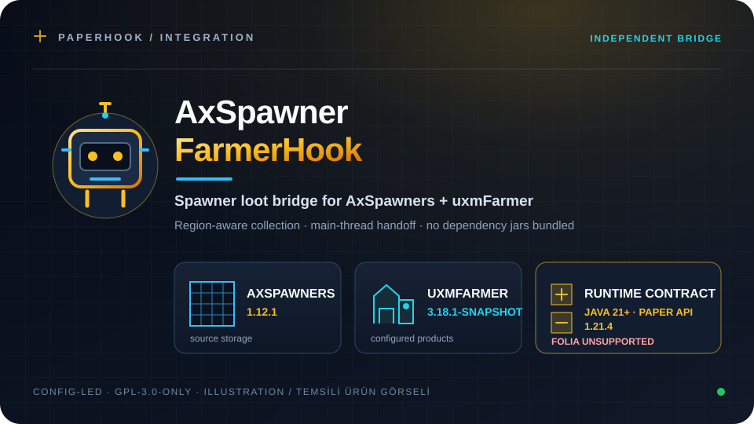
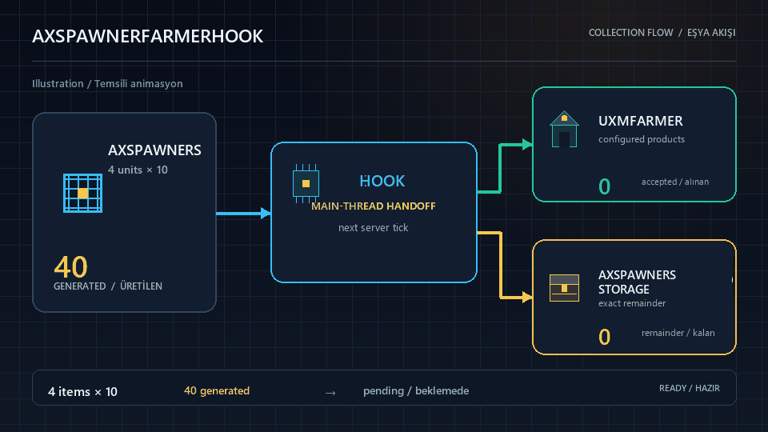

# AxSpawnerFarmerHook

**Türkçe** · [**English**](README.en.md)


[](LICENSE)
[](https://github.com/SerhatDew/axspawners-uxmfarmer/releases/latest)

<p align="center"></p>

AxSpawners'ın yeni ürettiği eşyaları, spawner'ın bulunduğu bölgedeki uxmFarmer'a aktaran bağımsız Paper eklentisi. AxSpawners veya uxmFarmer üzerinde değişiklik gerektirmez.

[**En yeni JAR'ı indir**](https://github.com/SerhatDew/axspawners-uxmfarmer/releases/latest/download/AxSpawnerFarmerHook.jar) · [Sürüm notları ve SHA-256](https://github.com/SerhatDew/axspawners-uxmfarmer/releases/latest)



*Temsili işleyiş animasyonu; oyun içi kayıt değildir.*

[İndir](#indir) · [Özellikler](#özellikler) · [Gereksinimler](#gereksinimler) · [Kurulum](#kurulum) · [Derleme](#derleme) · [Toplama kuralları](#toplama-kuralları) · [Sorun giderme](#sorun-giderme)

## Özellikler

- Yeni üretilen AxSpawners eşyalarını spawner bölgesindeki uxmFarmer'a aktarır.
- Ana iş parçacığı handoff'u ve sabitlenmiş sıra miktarıyla çiftçiye sığmayan kısmı AxSpawners deposuna yollar.
- Ayrı ürün yapılandırması tutmadan mevcut AxSpawners ve uxmFarmer kurulumlarına köprü olur.

## İndir

Hazır `AxSpawnerFarmerHook.jar` dosyasını [en yeni GitHub Release sayfasından](https://github.com/SerhatDew/axspawners-uxmfarmer/releases/latest) indirin. Kaynaktan derlemiyorsanız **Source code** arşivini değil, sürüm varlıklarındaki JAR'ı kullanın.

## Gereksinimler

- Java 21 veya üzeri.
- Paper; proje 1.21.4 API'sine karşı derlenir. Paper 26.2 henüz doğrulanmadı. Folia desteklenmez.
- AxSpawners 1.12.1 ve uxmFarmer 3.18.1-SNAPSHOT.
- Kaynaktan derlemek için Maven 3.

Java 21 bytecode'u Java 25 ile uyumludur; bu, belirli bir sunucu sürümünün desteklendiği anlamına gelmez.

## Derleme

AxSpawners ve uxmFarmer'ı kendi lisans koşullarına uygun şekilde ayrıca edin. Bu eklentilerin jarları ve kaynakları bu repoda dağıtılmaz.

Jarları `AxSpawners-1.12.1.jar` ve `uxmFarmer-3.18.1-SNAPSHOT.jar` konumlarına koyup yerel Maven deposuna yükle:

```sh
mvn install:install-file -Dfile=AxSpawners-1.12.1.jar -DgroupId=com.artillexstudios -DartifactId=AxSpawners -Dversion=1.12.1 -Dpackaging=jar -DgeneratePom=true
mvn install:install-file -Dfile=uxmFarmer-3.18.1-SNAPSHOT.jar -DgroupId=com.uxplima -DartifactId=uxmFarmer -Dversion=3.18.1-SNAPSHOT -Dpackaging=jar -DgeneratePom=true
mvn clean verify
```

Çıktı: `target/AxSpawnerFarmerHook.jar`. Paper, AxSpawners ve uxmFarmer bağımlılıkları provided kapsamındadır ve jar'a eklenmez.
## Kurulum

1. AxSpawners ve uxmFarmer'ı, kendi gerekli bağımlılıklarıyla birlikte kurup etkinleştir.
2. `AxSpawnerFarmerHook.jar` dosyasını sunucunun `plugins` klasörüne koy.
   Aynı köprünün eski JAR'ını kaldır; eski ve yeni kopyayı birlikte çalıştırma.
3. Sunucuyu yeniden başlat.

Hook, `plugins/AxSpawnerFarmerHook/config.yml` dosyasını oluşturur:

```yaml
config-version: 1
collection:
  enabled: true
```

Eski sürümlerdeki `collect-spawner-drops: true|false` ayarı ilk açılışta `collection.enabled` alanına taşınır ve değeri korunur. Toplamayı kapatmak için `collection.enabled: false` yap. Ayarı değiştirdikten sonra yeniden başlat.

Üç bağımsız hook aynı yaşam döngüsü düzenini kullanır: altın/sarı robot bannerı gerçek plugin adı, Maven sürümü ve platformu gösterir; ardından yapılandırma, bağımlılık ve bağlantı adımları raporlanır. Yalnızca etkin bileşenler hazırsa süreli başarı mesajı yazılır. `collection.enabled: false` durumu başarı yerine `Pasif` olarak bildirilir; başlangıç hatası exception ile raporlanır. Kapanış önce yeni aktarımı engeller, ardından yalnızca hook'un kendi dinleyicisini ve görevini durdurup kuyruğu boşaltır. Tamamlanmamış başlangıç veya temizlik hatası başarılı kapanış olarak gösterilmez. Bu küçük log yardımcısı her JAR'ın kendi kaynaklarına dahildir; ortak plugin veya Maven modülü kurulmaz. PlugMan ile söküp takma desteklenmez; tam sunucu yeniden başlatması kullan.

## Toplama kuralları

- Yalnızca yeni üretilen eşyalar işlenir. Mevcut spawner deposu ve XP aktarılmaz.
- Çiftçi, spawner'ın konumuna göre uxmFarmer'ın yapılandırılmış bölge entegrasyonu üzerinden seçilir.
- Dünya uxmFarmer tarafından izin verilen dünyalardan olmalıdır. Çiftçi ve çiftçinin doğal eşya toplama anahtarı açık olmalıdır.
- Yalnızca tanımlanmış ve etkin ürünler toplanır. Özel eşya ve model-data kısıtları korunur.
- Ürün listesi `uxmFarmer/collected-materials.yml` içindeki `collected-materials` bölümüdür. `SPIDER_EYE`, `PRISMARINE_SHARD`, `PRISMARINE_CRYSTALS` ve `BLAZE_ROD` için de aynı kural geçerlidir; ayrı bir izin listesi yoktur. Tanımsız ürünler çiftçiye eklenmez, AxSpawners deposuna bırakılır.
- uxmFarmer'ın mevcut depolama servisi kullanılır; toplama olayları, istatistikler, üretim ve otomatik satış davranışı korunur.
- Stack miktarı loot olayı sırasında sabitlenir; sırada beklerken spawner sayısı değişirse üretilmiş miktar değişmez. Çiftçiye sığmayan miktar bölünmeden AxSpawners deposuna yazılır, ardından slotlar ve GUI bir kez güncellenir.
- AxSpawners'ın asenkron ürettiği eşyalar bir sonraki sunucu tick'inde ana iş parçacığında işlenir; AxSpawners'ın spawner döngüsü bu işlemi beklemez. Çiftçiye sığmayan kısım aynı anda AxSpawners deposuna eklenir.
- Hook kapanırken sırada bekleyen eşyalar teslim edilir; kapanıştan sonra üretilen eşyalar doğrudan AxSpawners deposuna gider.
- Ayrı bir ürün configi tutulmaz. uxmFarmer kendi yapılandırmasını yeniden yüklediğinde hook sonraki aktarımda güncel ürün tanımlarını kullanır.
- Depo kapasitesi AxSpawners 1.12.1'in batch kurallarıyla uygulanır: başlangıçta limitin altındaysa kalan miktar eklenir; limitteyse yalnızca aynı ürünün son eksik stack'i tamamlanır; limit aşılmışsa kalan eklenmez. Hook yere eşya atmaz; dolu depo sınırsız depolama garantisi vermez.
## Sorun giderme

| Belirti | Kontrol |
| --- | --- |
| Çiftçi hiç eşya toplamıyor | Hook'un `collection.enabled` ayarını, çiftçinin doğal eşya toplama anahtarını ve spawner'ın bulunduğu bölgedeki çiftçiyi kontrol et. |
| Yalnızca bazı ürünler toplanmıyor | uxmFarmer ürün tanımını, ürünün açık olmasını ve varsa model-data eşleşmesini kontrol et. |
| Çiftçiye sığmayan eşyalar kayboluyor | AxSpawners deposunun kapasitesini kontrol et. Depo doluyken AxSpawners'ın kendi taşma davranışı geçerlidir. |
| Hook başlatılamıyor | Konsoldaki ilk hatayı incele; `collection.enabled` YAML boolean olmalı (`true` veya `false` kullan). AxSpawners ve uxmFarmer'ın etkin olduğundan emin ol. |
| Otomatik üretilen eşyalar yere düşüyor | İncelenen AxSpawners 1.12.1 üretim/depo ekleme akışı yere eşya atmaz. Çalışan sunucunun AxSpawners jarı, diğer loot hookları ve spawner ayarları incelenmelidir; yalnızca uxmFarmer sürümünü güncellemek bu sorunun düzeldiğini kanıtlamaz. |

Sorun bildirirken sunucu, Java, AxSpawners ve uxmFarmer sürümleriyle ilgili konsol hatasını ekle. Token, parola ve oyuncu verilerini paylaşma.

1.0.1 review: asenkron aktarımda değişen spawner sayısının üretilmiş miktarı değiştirmesi ve kısmi çiftçi aktarımında erken slot güncellemesinin kalan eşyaları kaybettirmesi düzeltildi. Boş, bir slot limitli depoda 100 üretilen − 13 çiftçiye aktarılan = 87 depo senaryosu eski commit koduyla 64, yeni kodla 87 sonuç verdi.

1.1.0 doğrulaması: 24 test geçti. Ayrı smoke programında kapalı toplamanın listener/task oluşturmadığı, eski `false` değerinin korunduğu ve geçersiz config sonrasında güvenli kapanışta başarı mesajı yazılmadığı çalıştırıldı. Gerçek `StorageService.addProduct` kullanan izole aktarımda dört ürünün her biri için 40 eşya → 13 çiftçi + 27 Ax deposu, canlı ürün tanımı kaldırılınca 40 Ax deposu sonucu gözlendi. Asenkron kuyruk kapanışında 18 birim bir kez teslim edildi; sonraki 13 birim üreticide kaldı. Dünya, bölge ve kalıcı ürün nesneleri test doubles kullandı; canlı sunucudaki dünya/bölge aktarımı ve yere düşme sorunu bu çalıştırmada doğrulanmadı.

## Lisans

Hook kaynakları **GPL-3.0-only** ile lisanslıdır. Ayrıntılar: [LICENSE](LICENSE).

AxSpawners, uxmFarmer ve bunlara ait varlıklar kendi lisanslarına tabidir; bu kaynak dağıtımının parçası değildir.

